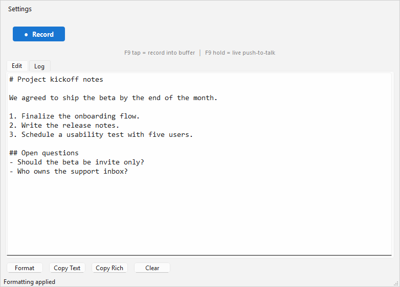
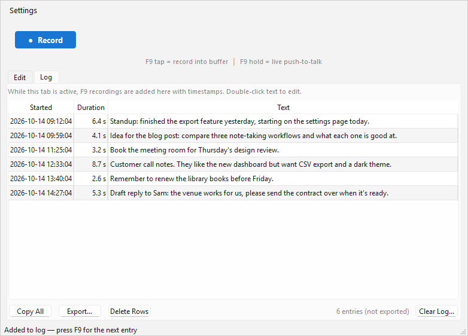
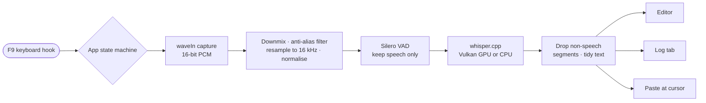

<h1 align="center">
  <br>
  WhisperVTT
</h1>

<p align="center">
  <strong>Offline voice typing for Windows.</strong><br>
  Push-to-talk dictation into any application, transcribed locally with OpenAI's Whisper model.<br>
  No network access, no account, no telemetry.
</p>

<p align="center">
  <a href="https://github.com/triwebb1/whispervtt/actions/workflows/ci.yml"></a>
  
  <a href="#verifying-the-offline-guarantee"></a>
  <a href="LICENSE"></a>
</p>

<p align="center">
  <a href="../../releases"><strong>Download</strong></a> ·
  <a href="#features">Features</a> ·
  <a href="#privacy">Privacy</a> ·
  <a href="#getting-started">Getting started</a> ·
  <a href="#architecture">Architecture</a> ·
  <a href="docs/SPEC.md">Specification</a>
</p>

<p align="center">
  <picture>
    <source media="(prefers-color-scheme: dark)" srcset="docs/images/editor-dark.png">
    
  </picture>
</p>

WhisperVTT is a system-tray application for writing by voice. Hold <kbd>F9</kbd> in any application, speak, and release: the transcription is typed at the cursor. Speech recognition runs entirely on the local machine, on the GPU when one is available and on the CPU otherwise, so audio and text never leave the computer.

## At a glance

| | |
|---|---|
| **Purpose** | Push-to-talk dictation into any application, plus a built-in editor and a timestamped dictation log |
| **Privacy** | Fully offline. The application contains no networking code, which CI verifies on every build |
| **Platform** | Windows 10 and 11, x64. GPU acceleration on NVIDIA, AMD and Intel hardware via Vulkan, with CPU fallback |
| **Stack** | C++17, Qt 6, CMake; [whisper.cpp](https://github.com/ggml-org/whisper.cpp) for inference; embedded [Silero VAD](https://github.com/snakers4/silero-vad) for speech detection |
| **Process** | Specification-driven. 81 numbered requirements in [docs/SPEC.md](docs/SPEC.md), each mapped to an automated test or a manual check; implemented with AI-assisted coding ([details](#about-this-project)) |

## Features

- **Dictation into any application.** Holding <kbd>F9</kbd> records; releasing it transcribes and pastes the text at the cursor of the application that had focus.
- **Draft mode.** Tapping <kbd>F9</kbd> starts a recording that is delivered to the built-in editor, for review before the text is copied elsewhere.
- **Spoken formatting.** Phrases such as *"heading"*, *"new paragraph"*, *"bullet point"* and *"First… Second…"* are converted to Markdown structure. **Copy Rich** places formatted HTML on the clipboard for Word, Google Docs or email.
- **Dictation log.** The **Log** tab records each dictation with start time and duration, supports in-place editing, and exports to TSV or JSON.
- **Hallucination suppression.** Voice activity detection removes silence before inference, which prevents Whisper's characteristic phantom phrases (*"Thank you."*) on quiet input.
- **Hardware-adaptive.** One package runs on any x64 PC, using a Vulkan-capable GPU if present. Model size is selectable to match the hardware.
- **Unobtrusive.** Runs from the system tray, follows the Windows light or dark theme, and can start at sign-in.

<p align="center">
  <picture>
    <source media="(prefers-color-scheme: dark)" srcset="docs/images/log-dark.png">
    
  </picture>
</p>

## Privacy

Most voice-typing services upload recordings to a remote server for transcription. WhisperVTT performs all processing locally and is built so that it cannot do otherwise: it contains no networking code, and the package excludes the networking components of the libraries it depends on.

- **No account, telemetry or update checks.** The application makes no network connections of any kind.
- **No retained audio.** Recordings are held in memory only for the duration of transcription.
- **No clipboard residue.** Push-to-talk text is placed on the clipboard only for the paste, marked to exclude it from clipboard history, cloud clipboard sync and clipboard monitors. The previous clipboard contents are then restored.
- **Minimal persistence.** The only user data written to disk is the optional dictation log, a plain JSON file under `%APPDATA%`.

### Verifying the offline guarantee

The claim is designed to be checked rather than trusted:

1. **Disconnect the network.** All functionality remains available.
2. **Observe it.** Resource Monitor's *Network* tab shows no activity from WhisperVTT during dictation, and blocking it in Windows Firewall has no effect.
3. **Inspect the binaries.** [`tools/verify-offline.ps1`](tools/verify-offline.ps1) checks that `WhisperVTT.exe`, `whisper.dll` and the ggml backends import no networking libraries (Winsock, WinHTTP, WinINet, DNS and IP helpers, Qt Network), and that the package contains no network-capable Qt modules or plugins. CI runs this check on every build, and releases are published only from passing builds.
4. **Review the source.** The complete source is available under the MIT license.

One caveat: `Qt6Core.dll` itself imports Winsock for host-name utilities. The application never calls them, and the process opens no sockets at runtime.

The only network transfer is the one-time download of the speech model from [Hugging Face](https://huggingface.co/ggerganov/whisper.cpp). The installer performs it on request and verifies the file against its published SHA-256 hash; alternatively, the model can be downloaded manually in a browser. WhisperVTT itself never downloads anything.

## Getting started

**Requirements:** Windows 10 or 11 (x64). A Vulkan-capable GPU is optional and substantially improves speed. Tested on Windows 11.

1. **Install.** Download `WhisperVTT-<version>-setup.exe` from [Releases](../../releases) and run it. The installer runs per user without administrator rights and offers to download a speech model appropriate for the detected hardware.
2. **Dictate.** Hold <kbd>F9</kbd>, wait for the start cue, speak, and release.

If no model was downloaded during installation, WhisperVTT explains where to obtain one on first launch and loads it as soon as it is present.

The installer is not code-signed, so Windows SmartScreen may display *"Windows protected your PC"*; select **More info → Run anyway** to proceed. A portable build, `WhisperVTT-<version>-win64-portable.zip`, runs from any folder without installation and stores models in its own `models` folder. The uninstaller asks before removing models, settings and the log.

### Choosing a model

| Hardware | Recommended model | Size |
|---|---|---:|
| Dedicated GPU | [`ggml-large-v3-turbo.bin`](https://huggingface.co/ggerganov/whisper.cpp/resolve/main/ggml-large-v3-turbo.bin) | 1.62 GB |
| CPU only | [`ggml-small.en.bin`](https://huggingface.co/ggerganov/whisper.cpp/resolve/main/ggml-small.en.bin) | 488 MB |

Model files are hardware-independent; WhisperVTT uses the GPU when available and the CPU otherwise. Place models in the models folder (**Settings → Model → Open Models Folder**) and select one under **Settings → Model**; changes take effect without a restart.

<details>
<summary><strong>All supported models</strong></summary>

Larger models are more accurate but require more memory and compute.

| Model | Size | Notes |
|---|---:|---|
| [`ggml-large-v3-turbo.bin`](https://huggingface.co/ggerganov/whisper.cpp/resolve/main/ggml-large-v3-turbo.bin) | 1.62 GB | Recommended with a GPU. Best balance of accuracy and speed. |
| [`ggml-large-v3-turbo-q8_0.bin`](https://huggingface.co/ggerganov/whisper.cpp/resolve/main/ggml-large-v3-turbo-q8_0.bin) | 874 MB | 8-bit quantised. Near-full accuracy at about half the size. |
| [`ggml-large-v3-turbo-q5_0.bin`](https://huggingface.co/ggerganov/whisper.cpp/resolve/main/ggml-large-v3-turbo-q5_0.bin) | 574 MB | 5-bit quantised. For GPUs with limited memory; slightly less accurate. |
| [`ggml-large-v3.bin`](https://huggingface.co/ggerganov/whisper.cpp/resolve/main/ggml-large-v3.bin) | 3.1 GB | Highest accuracy; requires a capable GPU and is the slowest. |
| [`ggml-medium.en.bin`](https://huggingface.co/ggerganov/whisper.cpp/resolve/main/ggml-medium.en.bin) | 1.53 GB | English-only alternative to turbo. |
| [`ggml-small.en.bin`](https://huggingface.co/ggerganov/whisper.cpp/resolve/main/ggml-small.en.bin) | 488 MB | Recommended for CPU-only systems. |
| [`ggml-base.en.bin`](https://huggingface.co/ggerganov/whisper.cpp/resolve/main/ggml-base.en.bin) | 148 MB | Fastest and least accurate; for older or low-power hardware. |

Transcription is English only. Other models from [ggerganov/whisper.cpp](https://huggingface.co/ggerganov/whisper.cpp/tree/main) are also supported.

</details>

## Usage

WhisperVTT starts in the system tray; double-click the tray icon to open the editor.

| Input | Behaviour |
|---|---|
| **Hold** <kbd>F9</kbd> | Push-to-talk. On release, the transcription is pasted into the previously focused application. |
| **Tap** <kbd>F9</kbd> or **Record** | Starts a recording. A second tap or **Stop** delivers the text to the editor, or to the **Log** if that tab is active. |
| **Format** | Converts spoken layout commands into headings, lists and paragraphs. |
| **Copy Text** / **Copy Rich** | Copies as Markdown, or as formatted HTML for Word, Google Docs or email. |

The tray icon indicates state: **blue** when idle, **red** while recording, **amber** while loading or transcribing. A two-tone cue signals that recording has started; a looping chime plays while the model loads on demand. Recordings are limited to 10 minutes.

| Spoken command | Result |
|---|---|
| *"new paragraph"* | Paragraph break |
| *"new line"* | Line break |
| *"heading …"*, *"sub heading …"* | Heading or sub-heading |
| *"bullet point …"* | Bulleted list item |
| *"First, … Second, … Third, …"* | Numbered list |

**Settings** (editor menu bar) provides **Enable GPU**, **Start with Windows**, **Model** and cue **Sound Volume**. Settings are stored under `HKCU\Software\WhisperVTT\WhisperVTT`; the log is stored at `%APPDATA%\WhisperVTT\transcript_log.json`.

## Architecture



Each design point below references the requirements in [docs/SPEC.md](docs/SPEC.md) that define it.

- **Specification-driven.** Behaviour, including states, thresholds, file formats and error handling, is defined as numbered requirements. The specification's verification section maps every requirement to the automated test or manual check that covers it.
- **Hardware-independent package (NF-6).** whisper.cpp's ggml backends are loaded at runtime from the application folder. The CPU backend is compiled for nine x86-64 instruction-set levels, from baseline to AVX-512, and the best match for the host CPU is selected at startup. The Vulkan backend supports NVIDIA, AMD and Intel GPUs through the standard graphics driver and falls back to the CPU if initialisation fails (MM-5).
- **Predictable first-use latency (MM-5a).** Vulkan drivers compile shader pipelines on first use. A warm-up inference during model load exercises the encoder, single-token and batched decoding paths, so that cost is not incurred by the first dictation.
- **Hallucination mitigation (AU-3, VD, TR-3).** The embedded Silero VAD removes non-speech before inference. Normalisation gain is capped at 50× to avoid amplifying background noise, silent microphones are detected before transcription, and non-speech segments such as `[BLANK_AUDIO]` are discarded.
- **Concurrency (HK-5, NF-3, NF-4).** The low-level keyboard hook runs on a dedicated thread with its own message loop, so it remains within Windows' hook timeout regardless of UI load. Model loading and transcription run on worker threads and are serialised against model unloading; pasting is timer-driven.
- **Clipboard hygiene (DL-3, DL-4).** Pasted text is tagged with the `ExcludeClipboardContentFromMonitorProcessing`, `CanIncludeInClipboardHistory` and `CanUploadToCloudClipboard` formats. The prior clipboard contents (text, rich text, HTML, images, file lists) are restored afterwards.
- **Testable core.** The recording state machine, model selection, audio conversion, transcript clean-up and formatting are pure logic, isolated from Win32 and Qt Widgets, and covered by unit tests.
- **Resource management (MM-6).** A GPU-resident model is released from VRAM after 60 seconds of inactivity and reloaded on the next recording.

## Building from source

| Requirement | Version | Notes |
|---|---|---|
| [Visual Studio 2022](https://visualstudio.microsoft.com/downloads/) or Build Tools | 17.10+ | *Desktop development with C++* workload, which includes CMake and Ninja |
| [Qt](https://www.qt.io/download-open-source) | 6.7+ (tested with 6.8.2) | `msvc2022_64`, Qt Base only. Alternatively: `pip install aqtinstall`, then `aqt install-qt windows desktop 6.8.2 win64_msvc2022_64 -O C:\Qt` |
| [Vulkan SDK](https://vulkan.lunarg.com/sdk/home#windows) | 1.3+ (tested with 1.4.363) | Required for GPU support. For a CPU-only build, use the `cpu` preset instead. |
| [Inno Setup](https://jrsoftware.org/isdl.php) | 6.5+ | Optional; required only to build the installer |

From an **x64 Native Tools Command Prompt for VS 2022**:

```bat
set QT_ROOT_DIR=C:\Qt\6.8.2\msvc2022_64
cmake --preset release
cmake --build --preset release
ctest --preset release
cmake --install build\release
```

`build\release\install` then contains a self-contained, portable build including the Qt, MSVC and OpenMP runtimes. The `installer` and `package` targets (for example, `cmake --build --preset release --target installer`) produce the setup program and the portable zip. whisper.cpp is fetched at configure time, pinned to a release tag (NF-7).

## Development

- **Specification.** [docs/SPEC.md](docs/SPEC.md) is the source of truth for behaviour. Changes to behaviour are made in the specification first, then in code and tests.
- **Tests.** Seven [Qt Test](https://doc.qt.io/qt-6/qttest-index.html) suites cover every state and input combination of the recording state machine, model selection, audio conversion (resampling, anti-aliasing, normalisation), transcript clean-up, log formats and formatting. An integration test exercises the clipboard code against the live Windows clipboard.
- **Continuous integration.** GitHub Actions builds and tests every push, runs the offline verification, and produces the installer and portable zip. Passing builds of `main` are published as the *Continuous build* prerelease.
- **Releases.** Update `project(VERSION …)` in `CMakeLists.txt` and push a matching tag (for example, `v1.1.0`); CI publishes the release and rejects tags that do not match the project version.
- **Diagnostics.** The `debug` preset writes a diagnostic log to `%TEMP%\whisper_vtt_debug.log`. Logging is compiled out of release builds, because the log contains transcribed text.
- The hotkey is defined as `VK_F9` in [`src/hotkeymanager.cpp`](src/hotkeymanager.cpp).

<details>
<summary><strong>Project layout</strong></summary>

```
src/
├── main.cpp, app.*        Entry point; recording flow, tray, settings, threads
├── recordingflow.*        ┐
├── modelcatalog.*         │
├── audioconvert.*         ├ Platform-independent core (unit-tested)
├── textcleanup.*          │
├── formatter.*            ┘
├── hotkeymanager.*        Global F9 hook on a dedicated thread (tap vs. hold)
├── audiorecorder.*        Microphone capture (Win32 waveIn)
├── transcriptlog.*        Log entries and their JSON/TSV formats (unit-tested)
├── transcriber.*          whisper.cpp and Silero VAD wrapper
├── clipboard.*            Private clipboard swap and full restore (integration-tested)
├── livetyper.*            Paste at cursor (focus restore, Ctrl+V)
├── editorwindow.*         Main window: Edit tab, controls, menus
├── logpanel.*             Log tab: persistence, editing, export
├── modelsetup.*           First-run model guidance
├── tones.*                Synthesised audio cues
└── debuglog.*             Optional diagnostic log
tests/                     Qt Test suites
installer/                 Inno Setup script for the Windows installer
tools/                     verify-offline.ps1
LICENSES/                  Third-party license texts (shipped in every package)
resources/                 Icon, version info, embedded VAD model
docs/                      Specification and screenshots
```

</details>

## Troubleshooting

| Symptom | Resolution |
|---|---|
| *"Speech model needed"* | No model is installed. Select **Download & Open Folder** in the prompt, or see [Choosing a model](#choosing-a-model). |
| *"Microphone is silent"* | Confirm the microphone is not muted, is the default input device, and that *Settings → Privacy & security → Microphone → Let desktop apps access your microphone* is enabled. |
| Push-to-talk does not paste into a specific application | Windows blocks input into elevated (administrator) applications from non-elevated ones. Run WhisperVTT as administrator to dictate into them. |
| **Enable GPU** is unavailable, or transcription is slow | GPU acceleration requires Vulkan support in the graphics driver. Update the NVIDIA, AMD or Intel driver; GPUs without Vulkan support fall back to the CPU. |
| F9 conflicts with another application | WhisperVTT intercepts only an unmodified F9. Ctrl, Shift, Alt and Win combinations with F9 pass through to other applications. |

## About this project

WhisperVTT is a personal project and an exercise in specification-driven development with AI-assisted implementation. I defined the requirements, architecture and quality criteria, recorded them as numbered requirements in the [specification](docs/SPEC.md), and used Claude Code to implement against that specification. Tests and CI checks trace back to those requirements.

I use it daily on Windows 11 with an NVIDIA GPU. It has not undergone the scrutiny expected of production software, such as independent code review, a security audit or testing across a broad range of hardware. Known limitations:

- English transcription only; Windows 10 and 11 (x64) only.
- Transcription begins after recording ends; there is no streaming output.
- Release binaries are not code-signed.

## License

Released under the [MIT license](LICENSE). Third-party components and their licenses are listed in [THIRD-PARTY-NOTICES.md](THIRD-PARTY-NOTICES.md).
