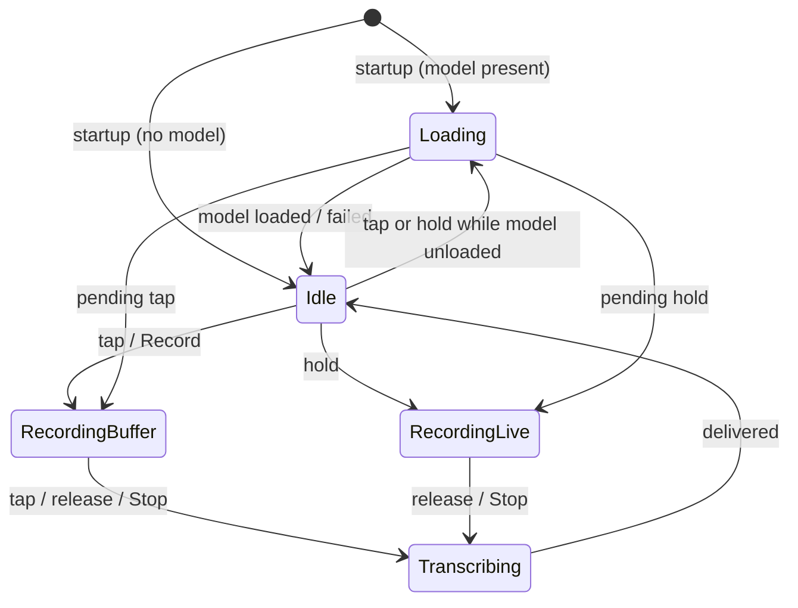

# WhisperVTT — Specification

**Version** 1.0 · **Status** Implemented

This document specifies the behaviour of WhisperVTT 1.0. Requirements are
numbered by area (`HK-1`, `AU-3`, …) and use **must** for mandatory behaviour.
The [Verification](#14-verification) section lists how each area is tested.

---

## 1. Overview

WhisperVTT is a Windows desktop application that converts speech to text
entirely on the local machine. The user holds or taps a global hotkey, speaks,
and receives the transcription either pasted at the cursor of the active
application, in a built-in editor, or in a timestamped log.

### 1.1 Goals

- Dictation into **any** application with a single key.
- **Fully offline** operation: no account, no network access, no telemetry.
- Output that is clean enough to use without correction: no hallucinated
  phrases from silence, no non-speech tags.
- Low friction: system-tray resident, quick start, GPU when available.

### 1.2 Non-goals

- Languages other than English.
- Platforms other than Windows 10/11 x64.
- Streaming (word-by-word) transcription while the user is still speaking.
- Speaker identification, translation, or audio file import.

### 1.3 Terms

| Term | Meaning |
|---|---|
| **Dictation** | One recording and its transcription. |
| **Buffer recording** | A dictation started and stopped with a *tap*; the result goes to the active tab. |
| **Live recording** | A dictation lasting as long as the hotkey is *held*; the result is pasted at the cursor. |
| **Destination** | Where a transcription is delivered: *Editor*, *Log* or *Paste*. |
| **Model** | A whisper.cpp `ggml-*.bin` speech-recognition model file. |

---

## 2. Hotkey

| ID | Requirement |
|---|---|
| HK-1 | The application must detect **F9** system-wide through a low-level keyboard hook. |
| HK-2 | A press released in **less than 400 ms** is a *tap*. A press held for **400 ms or longer** is a *hold*. The hold begins when the threshold elapses, not on release. |
| HK-3 | A plain F9 press must be consumed, so the foreground application does not receive it (including auto-repeat while held). F9 with Ctrl, Shift, Alt or Win held, and all other keys, must pass through untouched. The decision is made on key-down and kept until key-up. |
| HK-4 | Synthetic (injected) F9 events and key auto-repeat must be ignored. |
| HK-5 | The hook must run on a dedicated thread with its own message loop, so it keeps responding within the system's `LowLevelHooksTimeout` while the UI is busy. |
| HK-6 | If the hook cannot be installed, the user must be told (tray notification and status bar). The **Record** button must remain fully functional. |

## 3. Recording state machine

The application is always in exactly one of five states.



| ID | Requirement |
|---|---|
| RS-1 | **Idle:** a tap starts a buffer recording and a hold starts a live recording. If the model is not loaded, it is loaded first and the recording starts as soon as it is ready. |
| RS-2 | **Loading:** a tap reports "Still loading model…". Releasing a hold before loading completes must cancel the pending live recording, so the microphone never opens with no key held. |
| RS-3 | **RecordingBuffer:** a tap, the release of a long press, or **Stop** ends the recording. |
| RS-4 | **RecordingLive:** releasing F9 ends the recording, and the result is pasted. **Stop** also ends it, delivering to the active tab. Taps are ignored. |
| RS-5 | **Transcribing:** new recordings must not start; a tap reports "Transcription in progress…". For the *Paste* destination, this state lasts until the paste completes. |
| RS-6 | The destination of a buffer recording is fixed **when recording starts**: *Log* if the Log tab is active, otherwise *Editor*. |
| RS-7 | A recording shorter than **0.3 s** must be discarded with the status "Too short". |
| RS-8 | If no microphone can be opened, the state must stay *Idle* and the status must say so. |
| RS-9 | Starting a buffer recording must show and raise the editor window. A live recording must not change focus. |
| RS-10 | A recording must stop after **10 minutes** and be transcribed and delivered as usual, with a tray notification. |
| RS-11 | Only one instance may run per user session. Starting a second one shows a message pointing to the tray icon and exits. |

## 4. Audio capture

| ID | Requirement |
|---|---|
| AC-1 | Audio is captured from the system default input device as 16-bit PCM. Formats are tried in this order: 48 kHz mono, 44.1 kHz mono, 48 kHz stereo, 44.1 kHz stereo, 16 kHz mono. The first one the device accepts is used. |
| AC-2 | Capture must use a ring of 16 × 100 ms buffers (1.6 s of headroom), collected in the order the driver completes them. |
| AC-3 | The microphone device must be open **only** while a recording is in progress. |

## 5. Audio conditioning

Recorded audio is converted to whisper's input format on a worker thread.

| ID | Requirement |
|---|---|
| AU-1 | Multi-channel audio must be down-mixed to mono by averaging channels. |
| AU-2 | Audio not at 16 kHz must be low-pass filtered below the 8 kHz Nyquist limit (97-tap Blackman-windowed sinc, 7.2 kHz cutoff), then resampled to 16 kHz. Content above 8 kHz must not alias into the speech band (≥ 60 dB attenuation at 12 kHz). |
| AU-3 | If the peak level is below 0.8 of full scale, the signal must be normalised to a peak of 0.9. The gain is **capped at 50×** (≈ 34 dB) so background hiss is never amplified into "speech". |
| AU-4 | If the pre-normalisation peak is below **0.002** (≈ −54 dBFS), the microphone is considered silent. Transcription must be skipped and the status must read "Microphone is silent — check it isn't muted". |

## 6. Speech detection

| ID | Requirement |
|---|---|
| VD-1 | Before transcription, the audio must be filtered by the Silero VAD v6.2.0 model embedded in the executable. Parameters: speech threshold 0.5, minimum speech 250 ms, minimum silence 1000 ms, padding 300 ms. |
| VD-2 | Only the detected speech segments are passed to whisper, joined with 10 ms fades at each splice. Leading and trailing silence is removed, and pauses longer than one second are shortened. |
| VD-3 | If no speech is detected, the status must read "No speech detected" and nothing is delivered. |
| VD-4 | If the VAD model cannot be loaded or fails, the full recording must be transcribed instead. Failure of the VAD must never block transcription. |

## 7. Transcription

| ID | Requirement |
|---|---|
| TR-1 | Transcription uses whisper.cpp with greedy sampling, language fixed to English, no cross-dictation context, and non-speech tokens suppressed. |
| TR-2 | Worker threads: the number of logical cores, capped at 8. |
| TR-3 | Segments that are non-speech must be dropped: those consisting only of bracketed tags (`[BLANK_AUDIO]`, `(wind)`, `*sighs*`) or containing no letters or digits. |
| TR-4 | The remaining segments are joined with single spaces and trimmed. The first letter is capitalised, unless the first word is deliberately mixed case (`iPhone`, `eBay`). |
| TR-5 | Transcription must be abortable. On application exit, an in-flight transcription is aborted and awaited before the model is freed. |

## 8. Model management

| ID | Requirement |
|---|---|
| MM-1 | **Models folder:** `models\` next to the executable if that folder exists (portable mode), otherwise `%APPDATA%\WhisperVTT\models\`. The folder is created if missing. |
| MM-2 | **Model selection:** the configured model if it is present. Otherwise the first present from: `large-v3-turbo`, `large-v3-turbo-q8_0`, `large-v3-turbo-q5_0`, `large-v3`, `medium.en`, `medium`, `small.en`, `base.en`. Otherwise the alphabetically first `.bin`. The default configured model is `ggml-large-v3-turbo.bin`. |
| MM-3 | **Settings → Model** must list every `.bin` file in the models folder, mark the active one, and offer to open the folder. Choosing another model must take effect immediately, without restart. |
| MM-4 | The model is loaded asynchronously at startup. |
| MM-4a | If no model is installed, a setup dialog must be shown at startup, and again on F9 or **Record** (which then do nothing else). It recommends `large-v3-turbo` when **Enable GPU** is on and a dedicated graphics card is present, and `small.en` otherwise. It shows the models folder, and offers one action that opens the recommended model's download link in the browser and the models folder in Explorer. The application itself must not download anything (NF-1). |
| MM-4b | Until a model has loaded successfully, the models folder must be watched (on change, and every 2 s while a candidate file exists). A model is loaded only once it starts with the ggml file magic and its size and modification time are unchanged across two checks 2 s apart, so placeholders and copies in progress are skipped. A file that fails to load is retried once it changes. The setup dialog then closes, without a restart. |
| MM-5 | With **Enable GPU** on, the model is loaded on a Vulkan GPU device (a dedicated one if present, otherwise an integrated one) with flash attention. If GPU initialisation fails, it must fall back to the CPU automatically. When no usable GPU is available (CPU-only build, or no Vulkan driver), **Enable GPU** is shown disabled. |
| MM-5a | After a model loads on the GPU, a warm-up must run on 1 s of silence before the model is reported ready, so the driver's one-time pipeline compilation does not delay the first dictation. It must exercise every decoding shape a dictation uses: 128 single-token steps (end-of-text suppressed, no timestamps) and a short batched pass at non-zero temperature, as in temperature fallback. |
| MM-6 | While the model is on the GPU and the app is idle for **60 s**, the model must be unloaded to release VRAM. The next F9 or **Record** reloads it, playing the loading tone; nothing else does. |
| MM-7 | Changing the model or the GPU setting must be refused while not *Idle*, with any menu checkmarks restored. |

## 9. Delivery

| ID | Requirement |
|---|---|
| DL-1 | **Editor:** the text is appended to the Edit tab, separated from existing text by a blank line, without clearing the editor's undo history. The Edit tab is brought to the front. |
| DL-2 | **Log:** a log entry (§10) is appended. |
| DL-3 | **Paste:** focus is restored to the window that was in the foreground when recording started. The paste then waits (up to 1 s) for any held modifier keys to be released, puts the text plus a trailing space on the clipboard, and sends Ctrl+V. The dictated text must be marked private, so Windows keeps it out of clipboard history and cloud clipboard sync and clipboard managers ignore it. |
| DL-4 | 500 ms after a paste, the user's previous clipboard content must be restored in every memory-based format (text, rich text, HTML, images, file lists), or the clipboard emptied if it was empty. The dictated text never stays on the clipboard. This is skipped if another application changed the clipboard in the meantime. |
| DL-5 | If the clipboard cannot be accessed (it is retried for 200 ms), nothing is pasted and the user is told. |
| DL-6 | Live (*Paste*) dictations must never be written to disk, or left anywhere Windows keeps clipboard content (DL-3, DL-4). |

## 10. Transcript log

| ID | Requirement |
|---|---|
| LG-1 | Each entry records the **start** (microphone opened) and **end** (microphone closed) as ISO-8601 local time with milliseconds and UTC offset, the captured **duration** in seconds, and the **text**. |
| LG-2 | The log is stored at `%APPDATA%\WhisperVTT\transcript_log.json` and saved atomically (write-temp-then-rename) after every change. Entries persist across restarts and are unaffected by **Clear** on the Edit tab. |
| LG-3 | If an existing log file cannot be read, the user must be warned, and the file must **not** be overwritten for the rest of the session. |
| LG-4 | Entry text is editable in place (double-click). Start and duration are read-only. |
| LG-5 | Selected rows can be deleted after confirmation. Deleting every row, even a single one, follows the Clear rules (LG-6). |
| LG-6 | **Clear Log** asks for confirmation. If the log has changed since it was last exported, the user must type `DELETE` to confirm. |
| LG-7 | **Copy All** copies the log as tab-separated values. **Export** writes TSV (UTF-8 with BOM, for Excel) or JSON. The default file name spans the first and last entry, e.g. `transcript_log_2026-10-14_091204_to_2026-10-14_143212.tsv`. After exporting, the user is offered to clear the log. |
| LG-8 | Tab, CR and LF characters inside entry text are replaced by spaces in TSV output. |

**JSON format**

```json
{
  "entries": [
    {
      "start": "2026-10-14T09:12:04.318-05:00",
      "end": "2026-10-14T09:12:10.718-05:00",
      "duration_sec": 6.4,
      "text": "Standup: finished the export feature yesterday."
    }
  ]
}
```

**TSV format:** a header row `start`, `end`, `duration_sec`, `text` (tab-separated),
then one row per entry, with `duration_sec` to two decimal places.

## 11. Formatting

**Format** rewrites the Edit tab's text as Markdown. It is a pure, deterministic
text transformation.

| ID | Requirement |
|---|---|
| FM-1 | Voice commands (case-insensitive, whole words, including the punctuation whisper places around them): *new paragraph* → blank line · *new line*, *line break* → line break · *heading*, *title* → `# ` · *sub heading* → `## ` · *bullet*, *bullet point*, *dash* → `- `. Commands that are also everyday words (*heading*, *sub heading*, *title*, *bullet*, *dash*) count only at the start of a sentence or after a comma, so "We're heading home" is left alone. |
| FM-2 | A line containing sentence-initial ordinals in sequence ("First, … Second, … Third, …", up to *tenth*) is split into one item per ordinal. Any text before *first* stays as an introductory paragraph. |
| FM-3 | Two or more consecutive lines that begin with an ordinal become a numbered list (`1.`, `2.`, …), with the ordinal word removed. A single such line is left unchanged ("First of all, …" is prose). An ordinal that does not start a sentence ("wait a second") is never treated as a list item. |
| FM-4 | A line longer than 300 characters with more than four sentences is split into paragraphs of three sentences. Headings and list items are exempt. |
| FM-5 | Each line is trimmed, and its first word capitalised after any Markdown marker (mixed-case words excepted, as in TR-4). Headings lose a single trailing full stop. Runs of blank lines collapse to one. |
| FM-6 | **Copy Text** copies the Markdown source. **Copy Rich** copies rendered HTML, with the Markdown as the plain-text alternative. |

## 12. User interface and feedback

| ID | Requirement |
|---|---|
| UI-1 | The application lives in the system tray. Its tray icon is blue when *Idle*, red while recording, and amber while loading or transcribing. The tray menu offers **Show Editor**, **Enable GPU** and **Quit**. Double-clicking the icon shows the editor. |
| UI-2 | Closing the editor window hides it. The application exits only through **Quit**. |
| UI-3 | While recording, the editor shows a red control bar with an elapsed-time counter, a blinking indicator, the destination ("Recording → Log") and a **Stop** button. |
| UI-4 | Audio cues: a looping chime while the model loads on demand (after F9 or **Record**), and a short rising two-tone cue when recording starts. Their volume (0–100, default 70) is set from **Settings** and persisted. |
| UI-5 | Every user-visible outcome (ready, recording, transcribing, done, and each error in this document) must be reported in the status bar. |
| UI-6 | The UI must follow the Windows light/dark colour scheme. |

### Settings

| Setting | Storage | Default |
|---|---|---|
| Enable GPU | `HKCU\Software\WhisperVTT\WhisperVTT\gpu_enabled` | on |
| Model | `HKCU\Software\WhisperVTT\WhisperVTT\model_file` | `ggml-large-v3-turbo.bin` |
| Sound volume | `HKCU\Software\WhisperVTT\WhisperVTT\tone_volume` | 70 |
| Start with Windows | `HKCU\Software\Microsoft\Windows\CurrentVersion\Run\WhisperVTT` (quoted exe path) | off |

## 13. Non-functional requirements

| ID | Requirement |
|---|---|
| NF-1 | **Privacy:** the application must contain no networking code and make no network connections. Audio exists only in memory and is discarded after transcription. The only network use is the model download, made either by the installer (if the user opts in, and checked against the model's published SHA-256) or by the user in their own browser. |
| NF-1a | **Verifiable offline:** `WhisperVTT.exe`, `whisper.dll` and the ggml DLLs must not link any networking library (Winsock, WinHTTP, WinINet, DNS/IP helper, Qt Network). The package must not include Qt's networking module, network-capable Qt plugins (TUIO, TLS, network information) or ggml's RPC backend. `tools/verify-offline.ps1` checks both; CI runs it on every build, and releases are published only from passing builds. (`Qt6Core.dll` imports Winsock for host-name helpers; the process still owns no sockets at runtime.) |
| NF-2 | **Diagnostics:** a debug log (`%TEMP%\whisper_vtt_debug.log`) exists only in builds configured with `WHISPER_VTT_DEBUG`, because it contains transcribed text. In release builds, logging must compile to nothing. |
| NF-3 | **Responsiveness:** model loading and unloading, audio conversion and transcription must run on worker threads, and pasting is driven by timers. The UI thread only performs short, bounded operations: clipboard access (retried for at most 200 ms) and installing the keyboard hook at startup. |
| NF-4 | **Thread safety:** the whisper context must never be freed while in use. Load, unload and transcribe are serialised. |
| NF-5 | **Shutdown:** on exit, the hotkey is unhooked, recording stops, transcription is aborted, and all worker threads are joined before shared objects are destroyed. |
| NF-6 | **Deployment:** `cmake --install` must produce a self-contained folder that runs on a clean Windows machine. It includes the Qt and MSVC/OpenMP runtimes, plus an empty `models` folder (portable mode) with instructions. Models are never bundled. The package must not depend on the build machine's CPU or GPU: ggml's backends are DLLs loaded at runtime from the executable's folder only, with the CPU backend built for each x86-64 instruction-set level (the best one for the running CPU is chosen) and a Vulkan backend that loads only where the graphics driver provides Vulkan. |
| NF-6a | **Installer:** installs per user without an administrator prompt, adds a Start menu entry, and optionally a desktop shortcut and the sign-in entry used by **Start with Windows**. It does not install the portable `models` folder, so the installed app uses `%APPDATA%\WhisperVTT\models`. Unless a model is already there, it offers to download `large-v3-turbo` (preselected when a dedicated graphics card is detected) or `small.en`, or none. A failed download leaves the choice to install without a model. Upgrades remove stale ggml DLLs first. Uninstalling removes the sign-in entry and asks, defaulting to no, whether to delete models, settings and the Log. |
| NF-7 | **Reproducibility:** third-party sources are pinned to a release tag. |
| NF-8 | **Release:** every push to `main` that passes CI must publish its installer and portable zip as the rolling *continuous* prerelease. A version tag must publish a release, and is rejected if it does not match `project(VERSION)`. |

## 14. Verification

Automated tests (`ctest`, run by CI) cover the decision logic and the
clipboard; requirements that need a microphone, a GPU, the global hotkey or
another application's window are verified manually.

| Requirements | Verified by |
|---|---|
| RS-1 … RS-5 | `tests/tst_recordingflow.cpp`: every state × input combination |
| AU-1 … AU-3 | `tests/tst_audioconvert.cpp`: down-mixing, resampled length per input rate, anti-aliasing at 12 kHz, normalisation target, gain cap, loud-signal pass-through |
| AU-4 | `tst_audioconvert.cpp` (reported raw peak); threshold applied in `App` (manual) |
| TR-3, TR-4 | `tests/tst_textcleanup.cpp` |
| MM-2, MM-4a (recommendation), MM-4b (file magic) | `tests/tst_modelcatalog.cpp` |
| LG-1, LG-7, LG-8 (formats) | `tests/tst_transcriptlog.cpp`: JSON round trip with offsets, unreadable logs rejected, TSV flattening, export file name |
| DL-3, DL-4 (clipboard) | `tests/tst_clipboard.cpp`, against the real Windows clipboard: privacy markers set, text/HTML/image restored byte-for-byte, empty clipboard left empty |
| FM-1 … FM-5 | `tests/tst_formatter.cpp`, including everyday words that must not become commands |
| NF-1a | `tools/verify-offline.ps1`, run by CI on every build |
| HK, RS-6 … RS-11, AC, VD, MM, DL-1/2/5, LG, UI, NF-6a | Manual testing on Windows 11, with an NVIDIA GPU (via Vulkan) and CPU only |
